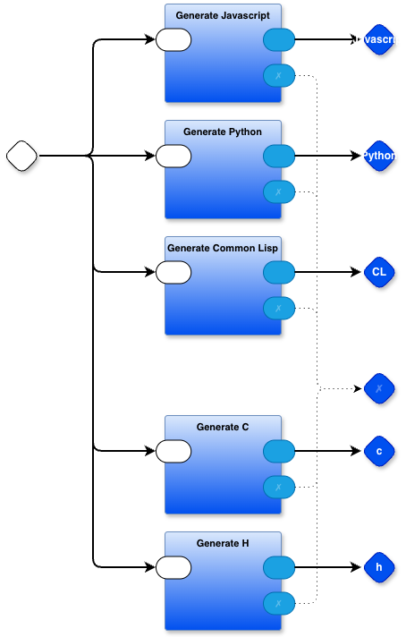

# Why Diagrams and DPLs?
2026-10-09

## Comments go out of sync with code

Comments go out of sync with code. Diagrams are a better version of comments. Diagrams are usually more meaningful than text.

## DPLs do not need to be Turing complete

DPLs (Diagrammatic Programming Languages), and any little textual languages, do not need to be Turing complete. A *combination* of DPLs and little languages might be Turing complete. Even programming languages and workflows that are not Turing complete can be useful.

We want to glue together a bunch of non-Turing-complete snippets to produce a complete result. If we want Turing-completeness, we simply need to ensure that the combination of snippets is Turing-complete.

## Diagrams are easy to parse and transmogrify

It is easy to parse diagrams and transmogrify them down into existing textual programming languages. We can do this using TDPLs (Top Down Parsing Languages) like OhmJS and the T2T toolkit.

This is practical now because several modern diagram editors save diagrams out as XML, graphML, SVG, etc. (e.g. drawio.com). That format is textual and is hard to read, but easy to parse - i.e. our current tools, such as text parsing languages, can be used to parse diagrams. In some cases, we might want to extract and infer more information from a diagram, say based on position, like (x,y), above, below, beside, or containment, like inside or on-the-boundary-of. We already have tools and techniques for inferring such information, e.g. relational programming languages like Prolog and its descendants, miniKanren or just plain looping and recursive code.

## Example
Below is an image of one of the diagrams in the PBP kernel.

Note that it shows various ideas that are harder to express in text form, like fan-out and fan-in. Fan-out is seen as the multiple flows emanating from the white rhombus (the input gate) at the left side of the diagram. Fan-in is seen as multiple flows terminating at the blue rhombus, labelled "✗" on the right hand side.

The diagram does not specify an execution order for the boxes. Each blue-ish box has one[^2] input queue where messages ("mevents"[^3]) pile up on the queue in order of arrival. The boxes run when the PBP kernel notices that any box has inputs on its input queue. This is very similar to how operating systems run processes, but can be implemented in a much lighter weight manner in programming languages instead of being relegated to operating systems.

It should be immediately obvious that this diagram shows a code generator. It generates code - concurrently "at the same time" - for several programming languages (Python, Javascript, Common Lisp, C).

This diagram does not need to show *all* of the detail of the code generator. Yet, it gives a quick overview of how the generator works. Interested readers can dig down into the boxes to see more detail. Theoretically, we should be able to organize function-based code in this same manner - eliding detail and moving it into other functions - but, I find that this diagrammatic form is easier to quickly understand. 

A difference between this DPL representation and a function-based representation is that each box is completely isolated from each other box. Boxes communicate only by sending messages through their ports to other boxes. In a function-based representation, though, functions *call* other functions, *blocking* themselves until the callee has finished. This causes tight control-flow coupling between functions and unnecessarily synchronizes them at a low level. Loose coupling allows more explicit control of the software architecture than function-based, implicit, tight coupling. 

With looser coupling, it becomes possible to use hierarchical layers instead of flat code sprawl, to describe larger systems.

## Reading / Viewing List

- Alan Kay In a 'real' Computer Science, the best languages of an era should serve as 'assembly code' for the next generation of expression [Alan Kay, 31:50](https://youtu.be/fhOHn9TClXY?t=1908)\
- [Stop Writing What Diagrams Can Generate](https://programmingsimplicity.substack.com/p/stop-writing-what-diagrams-can-generate?r=1egdky)\
- T2T / OhmJS / RWR are fundamental tools for transmogrifying diagrams to textual, runnable code. This [playlist](https://www.youtube.com/playlist?list=PLHh2_dCKBPjYEGrLE2IJAXp5V8eHBwzu4) walks through several examples of using T2T to create little languages (most of them DPLs), starting with the simplest version, i.e. just hand-compiling a diagram (a state diagram) to meta-code, then using T2T to transmogrify the meta-code into runnable Python and another example in which I use a DPL to create another DPL. I favour the concept of creating a little SCN[^1]/DPL for every project on a per-project basis, instead of prematurely generalizing the DPL and introducing accidental complexities (the YAGNI principle (You Aren't Going to Need It)).\

[^1]: SCN = Solution Centric Notation
[^2]: Note one input queue per part (box), not one input queue per port.
[^3]: Mevent = Message Event

# Appendix - T2T

T2T is one of the tools in the PBP toolkit — once you install PBP, you have access to T2T.

# Appendix RWR

RWR is part of T2T. This is the [specification for RWR](https://github.com/guitarvydas/pbp/blob/main/t2td/doc/rwr/RWR%20Spec.pdf)

RWR is a little language (a tiny DSL) for string manipulation and rewriting text into other text. RWR is not Turing complete, but, the combination of OhmJS and RWR into a toolset I call T2T ("text to text") is a powerful text matching and text rewriting tool.

RWR needs only a few operations\
- create new text by inserting character constants\
- create new text by inserting text interpolated by tree-walking the parameters passed in from the OhmJS parser\
- call Javascript support routines that return strings\
- push, pop and query user-defined stacks, much like Lisp's dynamically scoped variables\
	- this allows information to be passed _down_ the parse tree when tree-walking\
	- for example, if a rule needs to include a string from higher up in the tree, the string can be constructed (using rewrite operators) and pushed onto a parameter stack\
	- this is like pass-through parameters supplied to every function, except without the associated syntactic noise\
- string creation is recursive - string operators can take parameters that are themselves created strings\
# Appendix - PBP
[PBP tools](https://github.com/guitarvydas/pbp)

# Appendix - Further About PBP
[Towards Parts Based Programming](https://www.youtube.com/watch?v=IFcIptdG2sY&list=PLHh2_dCKBPjYBmubkBfn0LSbDMRKsr9Ui)\
[PBP cookbook playlist](https://www.youtube.com/watch?v=EFTzFA82YRc&list=PLHh2_dCKBPjbBN2R8xwBiS4nHlo5iQjqS)\
[Decision Tree Diagram Transmogrifier](https://www.youtube.com/playlist?list=PLHh2_dCKBPjYhpvWSvJNJdrsZE8lNHza7)\
[State Machine Diagram Tool](https://www.youtube.com/watch?v=ecJGkrpUhQQ&list=PLHh2_dCKBPjZEvCymkt1ZVualP7gt3e1O&index=17)\

[FDD LLM - 5 Whys Tool - code repository](https://github.com/guitarvydas/fdd-llm)\
[State Machine Tool - code repository](https://github.com/guitarvydas/sm-pbp)\
[Decision Tree Tool - code repository](https://github.com/guitarvydas/dtree)\
[PBP all tools (PBP, T2T, das2json)](https://github.com/guitarvydas/pbp)\

[The Spherical Cows of Programming](https://programmingsimplicity.substack.com/p/the-spherical-cows-of-programming) \
[The Wrong Spherical Cow - First Principles of Parts Based Programming](https://programmingsimplicity.substack.com/p/the-wrong-spherical-cow-first-principles?r=1egdky) \
[The Case For Composable Notations (1 / 5) - The Spherical Cow We Forgot We Were Riding](https://programmingsimplicity.substack.com/p/the-spherical-cow-we-forgot-we-were?r=1egdky) \
[The Case For Composable Notations (2 / 5) - The Restrictions That Came With The Cow](https://programmingsimplicity.substack.com/p/the-case-for-composable-notations?r=1egdky) \
[The Case For Composable Notations (3 / 5) - State Isn’t The Enemy](https://programmingsimplicity.substack.com/p/the-case-for-composable-notations-e6c?r=1egdky)\ 
[The Case For Composable Notations (4 / 5) - Ease of Expression Is the Whole Point](https://programmingsimplicity.substack.com/p/the-case-for-composable-notations-2bd?r=1egdky) \
[The Case For Composable Notations (5 / 5) - UNIX Already Showed Us the Way](https://programmingsimplicity.substack.com/p/the-case-for-composable-notations-f31?r=1egdky) \
[The Case For Composable Notations (6 / 5) - WIP - Notations in Progress](https://programmingsimplicity.substack.com/p/the-case-for-composable-notations-0d3?r=1egdky)\

# See Also

_Email_: [ptcomputingsimplicity@gmail.com](mailto:ptcomputingsimplicity@gmail.com)\
_Substack_: [paultarvydas.substack.com](http://paultarvydas.substack.com/)\
_Videos_: [https://www. youtube.com/@programmingsimplicity2980](https://www.youtube.com/@programmingsimplicity2980)\
_Discord_: [https://discord.gg/65YZUh6Jpq](https://discord.gg/65YZUh6Jpq)\
_Leanpub_: [https://leanpub.com/u/paul-tarvydas](https://leanpub.com/u/paul-tarvydas)\
_Twitter_: @paul_tarvydas\
_Bluesky:_ @paultarvydas.bsky.social\
_Mastodon:_ @paultarvydas\
_(earlier) Blog:_ [guitarvydas.github.io](http://guitarvydas.github.io/)\
_References:_ [https://guitarvydas.github.io/2024/01/06/References.html](https://guitarvydas.github.io/2024/01/06/References.html)\
_Notes and Back of the Napkin Scribbles_: [https://github.com/guitarvydas/napkin-notes](https://github.com/guitarvydas/napkin-notes])\

_Paid subscriptions are a voluntary way to support this work._