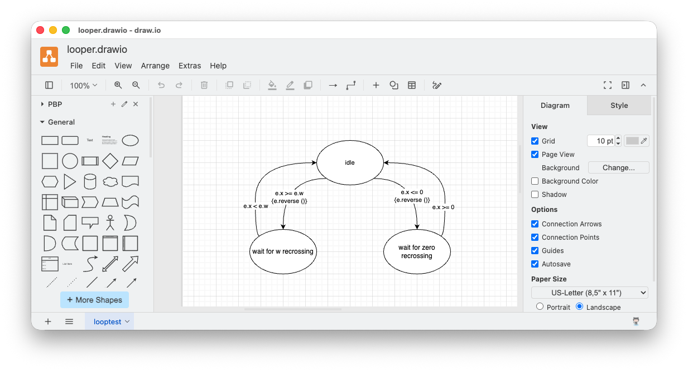

# SCNs - Building Them Quickly and Easily

2026-11-03

A short note on various experiments (and code repositories) regarding very small DSLs that I call SCNs (for Solution Centric Notation).

The goal is to produce little notations that express parts of a program better than can be expressed with current programming languages. 

The little notations - SCNs - don't need to be Turing complete, just useful.

The little notations - SCNs - only need to produce a snippet of code. The snippet can be included in a larger project by using COPY/PASTE in an editor or using something like the [m4](https://en.wikipedia.org/wiki/M4_(computer_language)) command line tool, or just some Javascript or Python (or whatever).

In the following examples, I lean towards targeting Python. I'm a Lisper at heart, but I think that more people can read Python, so I use Python to make my examples / experiments "more accessible". I've generated code for other languages, like Javascript, Odin, etc. The techniques described below can be used to generate code in just about any textual language.

In the following examples, I tend to used [ohmjs](https://ohmjs.org) only because I want to build quick and dirty parsers and Ohmjs seems to be the latest and greatest tool that I've found for doing this. As a bonus, ohmjs comes with ohm-editor which is a boon for developing grammars. In fact, I'd suggest using ohm-editor to quickly create and debug grammars, then hand-convert the grammar for use in other tools. It's just so much faster to use an interactive tool like ohm-editor than creating and debugging grammars in any other way. The manual rewrite time is but a minor cost compared to the time wasted doing this some other way. 

Ohmjs happens to be written in Javascript, but it can be used to parse and rewrite code in any language. 

I've created an SCN that I call [RWR](https://github.com/guitarvydas/pbp/blob/main/t2td/doc/rwr/RWR%20Spec.pdf) and have incorporated into the PBP toolkit. It's the backend of a tool that I call [T2T](https://programmingsimplicity.substack.com/p/why-t2t) which is a text-to-text rewriter (parse, then rewrite). T2T uses ohmjs for its front end and RWR for its back end.

## D2J Parser
```
d2j {
  Main = Array
  Array = "[" (KV | Object)+ "]"
  Object = "{" KV+ "}"
  KV = keystring ":" (Array | Object | string | emptyString | number)
  string = "\"" (~"\"" any)+ "\""
  keystring = string
  emptyString = "\"" "\""
  number = digit+
  space += ","
}
```

The above is an example of an SCN that I'm currently working on.

It expresses - in a syntax inspired by ohmjs and BNF - the very minimum required to parse the output of the `das2json.mjs` tool which converts diagrams - in DPL (Diagrammatic Programming Language) - syntax to a restricted form of JSON.

 The goal is to parse this output, and, convert/rewrite it to a programming language (Python, as stated above) to generate a little parser for this - and only this - kind of input. 
 
 At this point, a mockup of the parser consists of about 100 lines of Python code. This is likely to change as I proceed. To my eyes, the 11 lines of BNF-ish code above is much more expressive of what I want to accomplish than the Python code.

The general idea is to build programs as diagrams. For example, the "compiler" for the PBP kernel is written as a bunch of PBP diagrams - about 30 diagrams. The diagrams output restricted JSON which can be parsed by the above SCN. The kernel diagrams generate over 2,000 lines of restricted JSON, but the above 11-line SCN can ingest all of those 2,000 lines. I tested the above grammar using ohm-editor with the actual `kernel.drawio.json` generated from the kernel diagrams. Now, knowing that the grammar is OK - Ohmjs does a lot of checking and has PEG formal theory behind it - all I need to do is to convert the above SCN into Python and then I will have an automatically generated parser for all of the 2,000 lines of kernel.drawio.json. Later, I can easily revamp the T2T rewriting script to generate Javascript, Common Lisp and whatever. Currently I'm trying to generate "C", because most everyone believes that C is "more efficient" and "closer to the hardware" than those other languages.

I'm trying to capture some of my work in video form on this [playlist](https://www.youtube.com/playlist?list=PLLklGkLmCilw). The last few videos (16 and 17) contain brainstorming (diagrams and code) that has led to the above little syntax. I've yet to produce a video about the above SCN and the Python code that it generates.

The PBP kernel has been working for several years. I'm just trying to make it even more simple and more understandable.

[d2jgen code repository (WIP)](https://github.com/guitarvydas/d2jgen)

## Decision Tree - DTREE Conversion to Python


More powerful SCNs can be created by dropping the text-only requirement and using a DPL - Diagrammatic Programming Language - where suitable. Hybrids of text and diagrams are perfectly fine.

Text is good for expressing transformations on data. Text is less good for expressing control flow.

Diagrams are good for expressing control flow, e.g. state machines, flowcharts like those of Drakon, data and event flow. 

Functions express data transformation - one lump of input data produces another lump of output data. 

Functions need kludges added to them to express control flow, e.g. GOTO, exceptions, CPS[^1], allowing RETURN statements anywhere inside functions, etc.

[^1]: CPS == GOTO with a new name

If-then-else is a function-mapping relationship - a conditional mapping of data from one form to another, like we learned in high school math. When if-then-else is used, instead, for control flow, we end up inventing constructs like flags and unconstrained use of state.

The decision tree project - `dtree` - allows us to draw control flows based on simple decisions, yes or no.

In this [video]([https://youtu.be/dZ4p7T3VTcg](https://youtu.be/dZ4p7T3VTcg), I was working on a different project - a Forth-ish like language that I called "frish". I knocked together a DPL with only a few constructs, yes/no decisions based on calls to predicates, and, actions. In this video, I show how to generates "frish" meta-code. Later, I converted the dtree transmogrifier to generate Python code and Javascript code.

The dtree transmogrifier is written as a set of diagrams, as shown in this [playlist](https://www.youtube.com/playlist?list=PLHh2_dCKBPjYhpvWSvJNJdrsZE8lNHza7). The playlist leans towards showing how to refactor the diagrams into diagrams that are more expressive (IMO).

[dtree code repository](https://github.com/guitarvydas/dtree)

[frish code repository](https://github.com/guitarvydas/frish)\
[Statecharts PWL Toronto 2019](https://guitarvydas.github.io/2023/11/27/Statecharts-Papers-We-Love-Video.html)\
[Drakon Tutorial Part 1](https://www.slideshare.net/slideshow/drakon-part1-eng/22563246)\
[Drakon Tutorial Part 2](https://www.slideshare.net/slideshow/drakon-part2-eng/22758304)\
[Drakon Tutorial Part 3](https://www.slideshare.net/slideshow/drakon-part3-eng/22894119?from_search=0)\


## State Machine Conversion to Python


In this [video](https://youtu.be/ecJGkrpUhQQ) I drew a diagram of a simple state machine. It isn't even necessary to build a diagram transmogrifier.

The diagram was manually translated into a textual meta-language, then the T2T tools were used to convert the meta language into Python code. 

This little diagram becomes 21 lines of Python. I find that the diagram expresses my desired control flow better than the Python code does.

In essence, the diagram is a new programming language. Python is just used as assembler code. [Alan Kay](https://youtu.be/fhOHn9TClXY?t=1909) said "In a 'real' Computer Science, the best languages of an era should serve as 'assembly code' for the next generation of expression". 

[sm-pbp code repository](https://github.com/guitarvydas/sm-pbp)

## Kibitzing and Collaboration

If anyone wants to look over my shoulder, kibbitz or participate, please find me on the [programming simplicity discord](https://discord.gg/6TrzW5J52a)[^2] and see my substack articles, blogs, and youtube channel.

[^2]: Advertisements for work are not allowed.

# See Also

_Email_: [ptcomputingsimplicity@gmail.com](mailto:ptcomputingsimplicity@gmail.com)\
_Substack_: [paultarvydas.substack.com](http://paultarvydas.substack.com/)\
_Videos_: [https://www. youtube.com/@programmingsimplicity2980](https://www.youtube.com/@programmingsimplicity2980)\
_Discord_: [https://discord.gg/65YZUh6Jpq](https://discord.gg/65YZUh6Jpq)\
_Twitter_: @paul_tarvydas\
_Bluesky:_ @paultarvydas.bsky.social\
_Mastodon:_ @paultarvydas\
_(earlier) Blog:_ [guitarvydas.github.io](http://guitarvydas.github.io/)\
_another earlier Blog (raw form):_ https://github.com/guitarvydas/missing-blogs\
_References:_ [https://guitarvydas.github.io/2024/01/06/References.html](https://guitarvydas.github.io/2024/01/06/References.html)\
_Back of the Napkin Notes_: [https://github.com/guitarvydas/napkin-notes](https://github.com/guitarvydas/napkin-notes])\
_books: WIP Leanpub_: [https://leanpub.com/u/paul-tarvydas](https://leanpub.com/u/paul-tarvydas)\

_Paid subscriptions are a voluntary way to support this work._