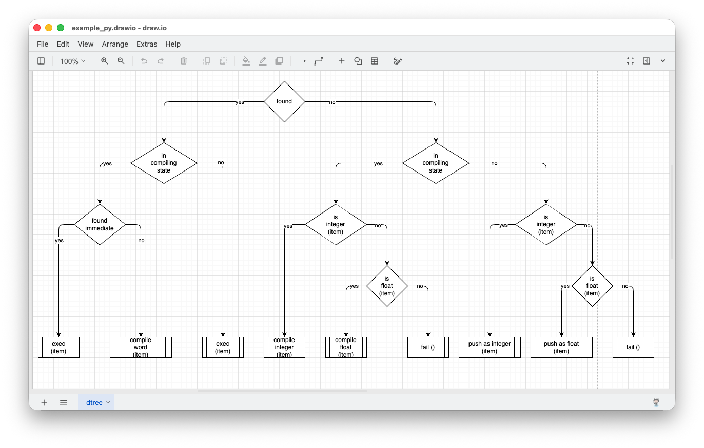

# Simplifying Notations - Towards Composable Notations

2026-11-05

It might be possible to draw something that represents recursion and mutual recursion in a diagram, like the dtree example given below,



Despite this possibility, I am of the opinion that it is better to use diagrams for what they are good at and to use text for what it is good at.

A reasonable _simplifying notation_ should not be an attempt to cover every possible use-case. Turing-completeness is over-rated at the code snippet level. A complete workflow might need to be Turing-complete, but a piece of code - an SCN[^1] - need not be. What we call "programming languages" are just 20th century, cave-man attempts to create IDEs for programming computers, tainted by the desire to formalize the process. 21st century IDEs should support many, disparate SCNs (little languages) and provide Turing-completeness as only an aspect of the overall workflow.

[^1]: SCN == Solution Centric Notation

There are several kinds of control flow at this level:

1. looping
2. recursion
3. feedback
4. if-elif (no else)

Looping and feedback are not well handled in text (not impossible, just less expressive to human readers). They are better handled in diagrammatic form. Drakon for looping, PBP and message-passing for feedback.

Recursion is better handled using a textual notation. 

`Else` is just a lazy way to handle not having to specify every decision-case in a textual notation, tangled up with branching control flow. It should actually be written in a declarative manner something like
```
if (x) {
...
}
if (not x) {
...
}
```
(which, of course IMO, is better written in diagrammatic form, or at least in Prolog-ish relational form).

We are forced to learn recursion because, in the 20th century, we were stuck with machines that could conveniently handle 500-year old, Gutenberg type-setting notations, but were too weak to handle diagrams, and because we (incorrectly, IMO) thought that mathematic, type-set notation would be the best - and the only - way to write programs for controlling computers. 21st century hardware is very different from what we had in the last century. IMO, it is time to re-think our approach to using this new kind of hardware.

## References
[Drakon Tutorial Part 1](https://www.slideshare.net/slideshow/drakon-part1-eng/22563246)\
[Drakon Tutorial Part 2](https://www.slideshare.net/slideshow/drakon-part2-eng/22758304)\
[Drakon Tutorial Part 3](https://www.slideshare.net/slideshow/drakon-part3-eng/22894119?from_search=0)\
[SCNs - Building Them Quickly and Easily](https://programmingsimplicity.substack.com/p/scns-building-them-quickly-and-easily?r=1egdky)

# Appendix - PBP

[PBP tools](https://github.com/guitarvydas/pbp)

# Appendix - Further About PBP
[Towards Parts Based Programming](https://www.youtube.com/watch?v=IFcIptdG2sY&list=PLHh2_dCKBPjYBmubkBfn0LSbDMRKsr9Ui)\
[PBP cookbook playlist](https://www.youtube.com/watch?v=EFTzFA82YRc&list=PLHh2_dCKBPjbBN2R8xwBiS4nHlo5iQjqS)\
[Decision Tree Diagram Transmogrifier](https://www.youtube.com/playlist?list=PLHh2_dCKBPjYhpvWSvJNJdrsZE8lNHza7)\
[State Machine Diagram Tool](https://www.youtube.com/watch?v=ecJGkrpUhQQ&list=PLHh2_dCKBPjZEvCymkt1ZVualP7gt3e1O&index=17)\

[FDD LLM - 5 Whys Tool - code repository](https://github.com/guitarvydas/fdd-llm)\
[State Machine Tool - code repository](https://github.com/guitarvydas/sm-pbp)\
[Decision Tree Tool - code repository](https://github.com/guitarvydas/dtree)\
[PBP all tools (PBP, T2T, das2json)](https://github.com/guitarvydas/pbp)\

[The Spherical Cows of Programming](https://programmingsimplicity.substack.com/p/the-spherical-cows-of-programming) \
[The Wrong Spherical Cow - First Principles of Parts Based Programming](https://programmingsimplicity.substack.com/p/the-wrong-spherical-cow-first-principles?r=1egdky) \
[The Case For Composable Notations (1 / 5) - The Spherical Cow We Forgot We Were Riding](https://programmingsimplicity.substack.com/p/the-spherical-cow-we-forgot-we-were?r=1egdky) \
[The Case For Composable Notations (2 / 5) - The Restrictions That Came With The Cow](https://programmingsimplicity.substack.com/p/the-case-for-composable-notations?r=1egdky) \
[The Case For Composable Notations (3 / 5) - State Isn’t The Enemy](https://programmingsimplicity.substack.com/p/the-case-for-composable-notations-e6c?r=1egdky)\ 
[The Case For Composable Notations (4 / 5) - Ease of Expression Is the Whole Point](https://programmingsimplicity.substack.com/p/the-case-for-composable-notations-2bd?r=1egdky) \
[The Case For Composable Notations (5 / 5) - UNIX Already Showed Us the Way](https://programmingsimplicity.substack.com/p/the-case-for-composable-notations-f31?r=1egdky) \
[The Case For Composable Notations (6 / 5) - WIP - Notations in Progress](https://programmingsimplicity.substack.com/p/the-case-for-composable-notations-0d3?r=1egdky)\

# See Also

_Email_: [ptcomputingsimplicity@gmail.com](mailto:ptcomputingsimplicity@gmail.com)\
_Substack_: [paultarvydas.substack.com](http://paultarvydas.substack.com/)\
_Videos_: [https://www. youtube.com/@programmingsimplicity2980](https://www.youtube.com/@programmingsimplicity2980)\
_Discord_: [https://discord.gg/65YZUh6Jpq](https://discord.gg/65YZUh6Jpq)\
_Twitter_: @paul_tarvydas\
_Bluesky:_ @paultarvydas.bsky.social\
_Mastodon:_ @paultarvydas\
_(earlier) Blog:_ [guitarvydas.github.io](http://guitarvydas.github.io/)\
_another earlier Blog (raw form):_ https://github.com/guitarvydas/missing-blogs\
_References:_ [https://guitarvydas.github.io/2024/01/06/References.html](https://guitarvydas.github.io/2024/01/06/References.html)\
_Back of the Napkin Notes_: [https://github.com/guitarvydas/napkin-notes](https://github.com/guitarvydas/napkin-notes])\
_books: WIP Leanpub_: [https://leanpub.com/u/paul-tarvydas](https://leanpub.com/u/paul-tarvydas)\

_Paid subscriptions are a voluntary way to support this work._