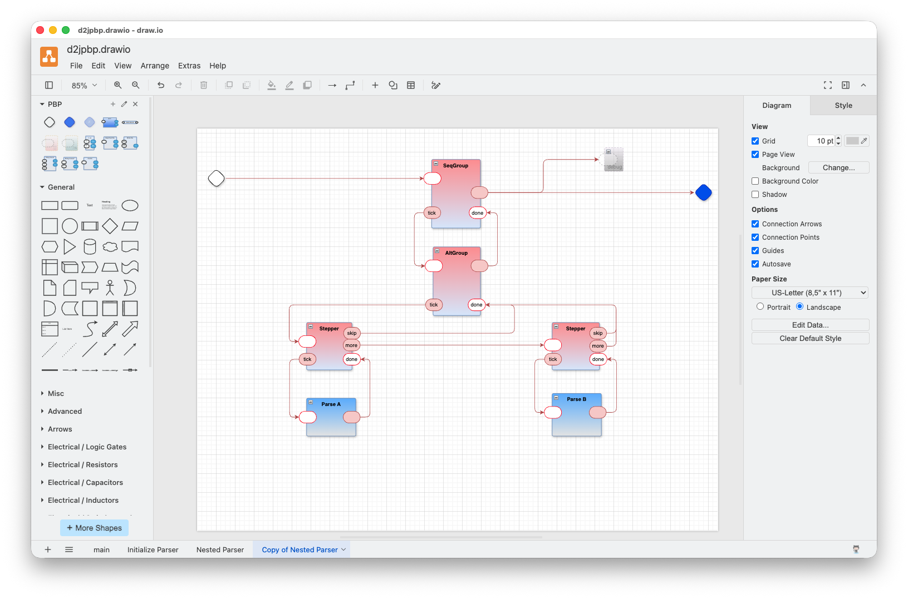

# Inventing A Simplifying Notation

2026-11-17

This video is part 18 of a train of thought on how to port the PBP kernel to C: [https://youtu.be/hC7Oazr3kuw](https://youtu.be/hC7Oazr3kuw)

It contains a significant AHA moment. I invent a simple little SCN[^1] (a tiny DSL) to describe the code I want.

[^1]: SCN == Solution Centric Notation

## The problem

I'm trying to solve the problem of how to inhale a 2,000 line JSON file generated from the PBP kernel diagram without having to buy in a full-blown JSON parsing library.

I end up with an 11 line grammar that seems to do the job. I develop and test the grammar using [Ohm-editor](http://ohmjs.org/). From experience, I feel that I will be able to generate Python and C code from this - we'll see (I'm not done yet and might hit road blocks or change my mind).

## Scope

This doesn't solve the whole problem of porting the kernel to C. It is only an attack at a sub-sub-problem - how to inhale a regular, restricted JSON file and convert it to some internal data structures.

In this video, I'm only dealing with the sub-sub-problem - how to read the JSON file. Once I can do that, it "will become obvious" how to generate internal data structures from the pattern match ("parse").

## The SCN

I make a few concessions to simplicity and parseability and compose an SCN that meets the needs of parsing the full-blown problem *AND* is a subset of OhmJS.

This means that I can use Ohm-editor to invent and check the SCN syntax. I don't have to build code to check my work - I just buy in the OhmJS checker. Ostensibly, OhmJS is a parser generator, but I only use it for checking my invented grammar. I've seen this kind of thing done before - I witnessed someone building a recursive descent grammar while using YACC as a consistency checking tool.

## Cutting corners

This video shows the grammar and its testing. The grammar I need is only 11 lines long, but parses some 2,000 lines of kernel.drawio.json.

Kernel.drawio.json is very regular, since it is generated by a program (das2json). I can cut a lot of corners, and, if I stop myself from generalizing, I get an acceptable, but very small, grammar - 11 lines.

## The Invented SCN
```
d2j {
  Main = Array
  Array = "[" (| KV | Object)+ "]"
  Object = "{" KV+ "}"
  KV = keystring ":" (| Array | Object | string | emptyString | number)
  string = "\"" strchar+ "\""
  strchar = ~"\"" any
  keystring = string
  emptyString = "\"" "\""
  number = (| "0" | "1" | "2" | "3" | "4" | "5" | "6" | "7" |"8" | "9")+
}
```

## Next Steps

I'm going to use T2T to read the above grammar and to convert it to running Python code.

First, though, I'm going to mock-up a part of a grammar (parse "a" followed by "b") in PBP to get a feel for what operations I will need.

The WIP work for this mock-up is in my github [d2jpbp](https://github.com/guitarvydas/d2jpbp)

### Mock-up

Here's where I've gotten to. The blue boxes are calls to functions (parse_string). The red boxes and red arrows show control flow. The purple box at the upper right is just a debugging probe I've inserted into the diagram to watch what's going on.

I find that separating data from control flow is helping me think about what I want. Our penchant for tangling control flow into our functional  / function-based notation makes it harder to think about problems.

For example, alternation should result in branching code - once a call to a parsing function returns true, we can skip the rest of the calls to parsing functions. In this mock-up, the red box on the lower left ("Stepper" which invokes the blue box "Parse A") does the skipping. If the blue box below it returns "True" (on a value stack[^2]), the red box fires the "skip" port, else it fires the "more" port (without, also, firing the "skip" port).

[^2]: We must keep data and control flow separate. The drawing shows only control flow. Data is kept on stacks and lists and objects in the usual way.

This is the kind of logic that goes on inside compilers, although I've never seen this logic drawn out in executable, testable form like this.

## Failed Attempt

At first, I jumped into just writing the transpiler in text using T2T. Somewhere in the code, I created a bug(s). 

I played with the problem for several days. 

Then, I drew a diagram (as above) and got the (minimal) thing working in a few hours (elapsed time of several days). Most of the time was spent thinking and not coding / drawing.

Separating control flow from data made it much easier to think about. When thinking about the diagram, I ended up with a different design (different components) than, at first, I thought necessary. 

This shows the power of inventing a simplifying notation that is not over-generalized.

We'll see how this new design maps onto text ...

In this T2T version, I wrote another grammar for parsing the above grammar. I accompanied the grammar with a set of rewrite rules written in RWR form.

The T2T version appears to work for a simple grammar, but doesn't appear to work for the 11-line grammar above.

This simple grammar:
```
d2j {
  Main = a b
  a = "a"
  b = "b"
}
```

generates Python code:
```
from plib2 import *
def Main ():
    begin ("Main")
    r = declare (True)
    if r:
        seq1 = declare (True)
        #B SeqItem_preditem <- seq1
        if seq1:
            seq2 = declare (True)
            #B PredItem seq2
            seq2 = parse_ignoring (lambda :  a ())
            #E PredItem seq2
            seq1 = seq1 and seq2
        #E SeqItem_preditem -> seq1
        #B SeqItem_preditem <- seq1
        if seq1:
            seq3 = declare (True)
            #B PredItem seq3
            seq3 = parse_ignoring (lambda :  b ())
            #E PredItem seq3
            seq1 = seq1 and seq3
        #E SeqItem_preditem -> seq1
        r = r and seq1
    if r:
        return accept ("Main")
    else:
        return fail ("Main")
def a ():
    begin ("a")
    r = declare (True)
    if r:
        seq1 = declare (True)
        #B SeqItem_preditem <- seq1
        if seq1:
            seq2 = declare (True)
            #B PredItem seq2
            seq2 = parse_string ("a")
            #E PredItem seq2
            seq1 = seq1 and seq2
        #E SeqItem_preditem -> seq1
        r = r and seq1
    if r:
        return accept ("a")
    else:
        return fail ("a")
def b ():
    begin ("b")
    r = declare (True)
    if r:
        seq1 = declare (True)
        #B SeqItem_preditem <- seq1
        if seq1:
            seq2 = declare (True)
            #B PredItem seq2
            seq2 = parse_string ("b")
            #E PredItem seq2
            seq1 = seq1 and seq2
        #E SeqItem_preditem -> seq1
        r = r and seq1
    if r:
        return accept ("b")
    else:
        return fail ("b")
```

I plan to rewind and incorporate the fresh ideas into the T2T version. I will report on my progress.

The intermediate version (WIP) is in branch `rwr8` of the repository [d2jgen](https://github.com/guitarvydas/d2jgen/tree/rwr8)

# Appendix - T2T

T2T is one of the tools in the PBP toolkit — once you install PBP, you have access to T2T.

# Appendix - PBP
[PBP tools](https://github.com/guitarvydas/pbp)

# See Also

_Email_: [ptcomputingsimplicity@gmail.com](mailto:ptcomputingsimplicity@gmail.com)\
_Substack_: [paultarvydas.substack.com](http://paultarvydas.substack.com/)\
_Videos_: [https://www. youtube.com/@programmingsimplicity2980](https://www.youtube.com/@programmingsimplicity2980)\
_Discord_: [https://discord.gg/65YZUh6Jpq](https://discord.gg/65YZUh6Jpq)\
_Twitter_: @paul_tarvydas\
_Bluesky:_ @paultarvydas.bsky.social\
_Mastodon:_ @paultarvydas\
_(earlier) Blog:_ [guitarvydas.github.io](http://guitarvydas.github.io/)\
_another earlier Blog (raw form):_ https://github.com/guitarvydas/missing-blogs\
_References:_ [https://guitarvydas.github.io/2024/01/06/References.html](https://guitarvydas.github.io/2024/01/06/References.html)\
_Back of the Napkin Notes_: [https://github.com/guitarvydas/napkin-notes](https://github.com/guitarvydas/napkin-notes])\
_books: WIP Leanpub_: [https://leanpub.com/u/paul-tarvydas](https://leanpub.com/u/paul-tarvydas)\

_Paid subscriptions are a voluntary way to support this work._