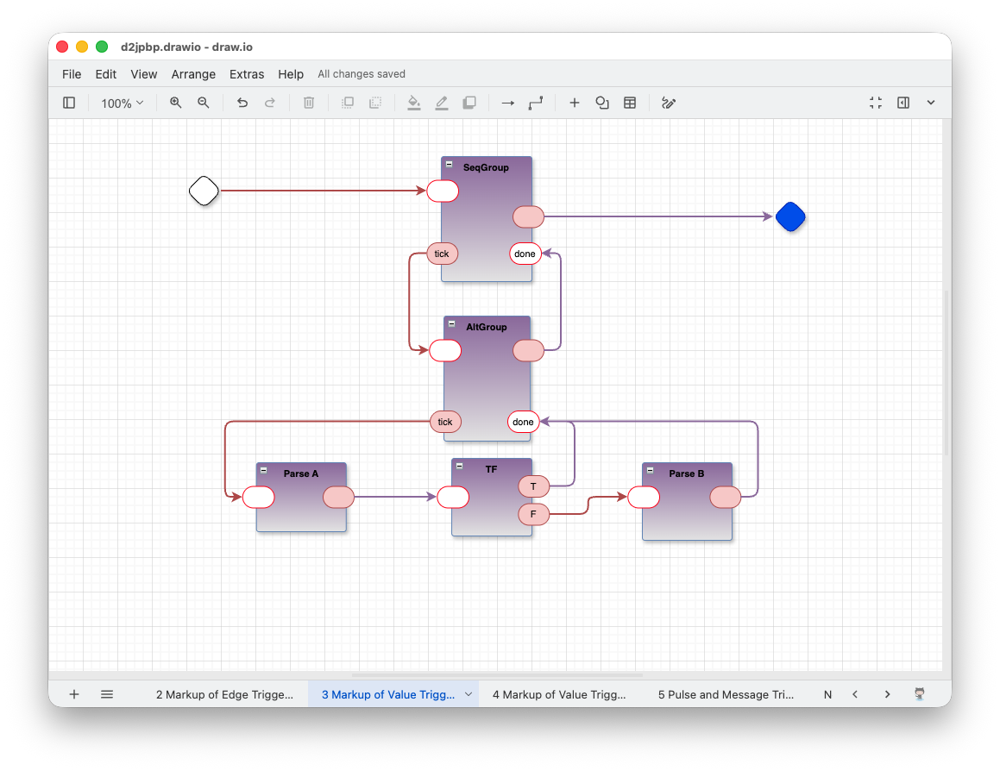
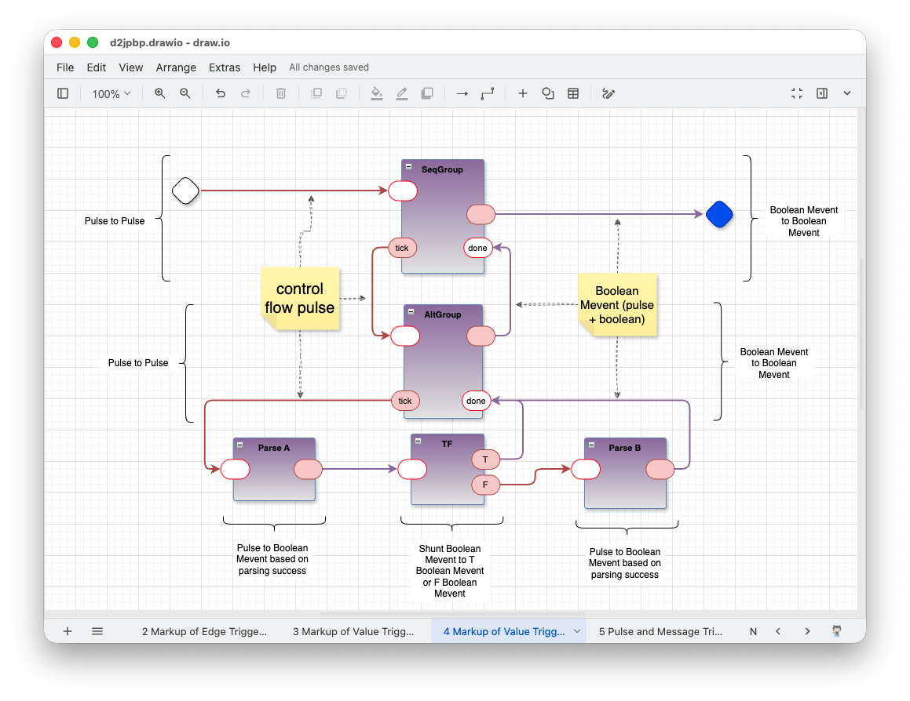
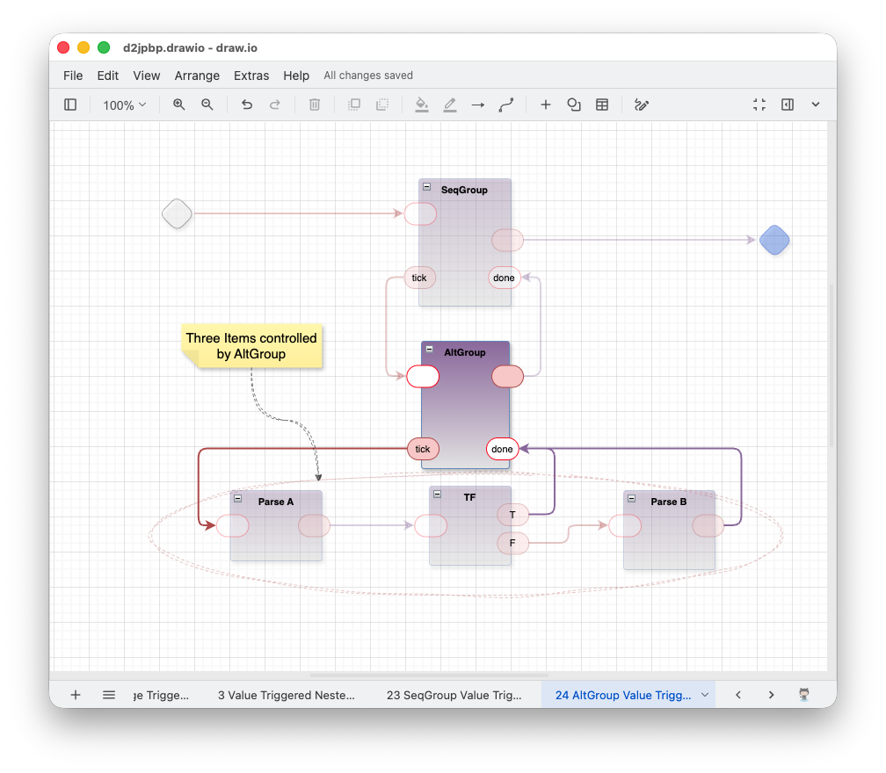
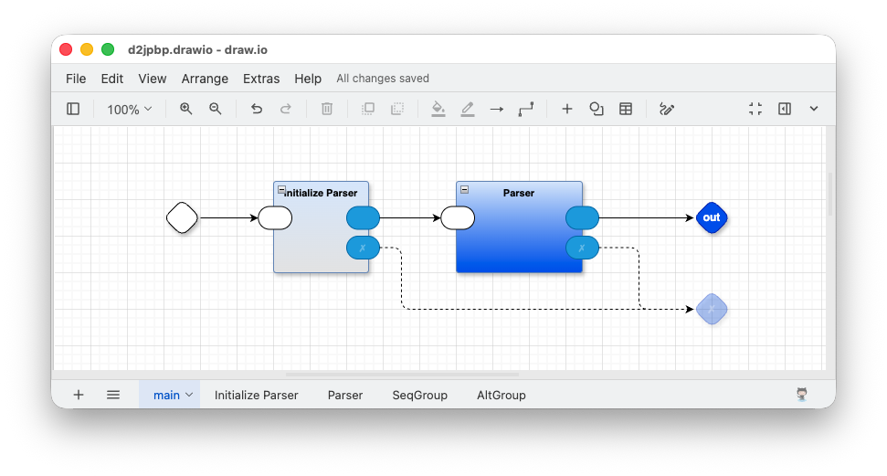
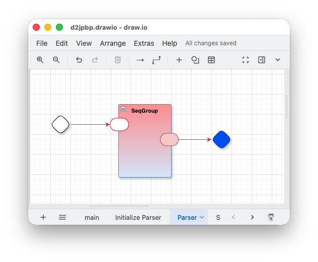
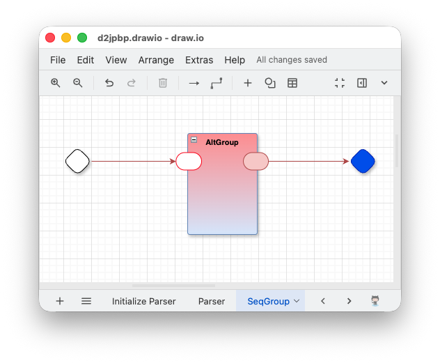
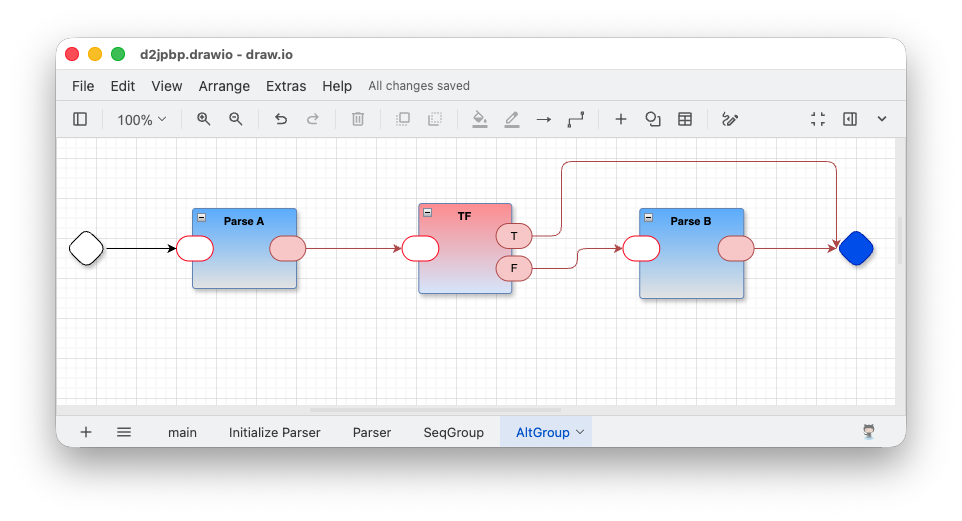

# Value Triggered Control Flow
2026-11-23

## Introduction

The focus of this article is to show how to split "control flow" away from traditional function-based programming notation.

Programs are not just data. Programs are `data` + `interpretation of data`.  Often, interpretation of data requires explicitly thinking about control flow. The various baubles that we've added to function-based programming languages - like *exceptions*, *async/await*, *threads*, etc. - are often not good enough for easy, clear reasoning about control flow.

I stumbled into exactly this problem when trying to think about how to write a simple parser generator. I needed to generate branching code and it turned out to be much easier to see what was needed when I switched to boolean-carrying mevents - control flow messages between software components. Once I created the diagrammatic form - like schematics in electronics - I found it easier to cast the design into text form using a textual language (Python). 

I created the custom parser using T2T technology. I believe that it will be a simple matter to tweak this parser generator to generate C code.

This is a spin-off from #23 in the video [playlist](https://www.youtube.com/playlist?list=PLLklGkLmCilw) which is a Twitch-like stream capture of thinking about how to port the PBP Kernel to C.

The kernel port is actually a transmogrifier that converts a pseudo syntax into working code. It already works with Python/Javascript/Common Lisp. Now I want to tackle the idea of transmogrifying to some statically typed language, like C. The issue is not how to emit C code, but how to insert enough type information somewhere in the process without making the meta-code too obfuscated and too noisy to read without requiring head-scratching and reverse engineering[^2].

As part of the process, the kernel needs to inhale a machine-generated JSON file that contains the JSON representation of about 30 drawings that make up the meta-code to C transmogrifier. I've been getting away with just buying in pre-built JSON parsing libraries, but, am reaching the conclusion that it might be simpler to build my own restricted-JSON-parser. At this point I can define the restricted-JSON-parser using only about 11 lines of code. Those 11 lines seem to successfully parse the 2,000 or so lines of machine-generated JSON that represent the drawings. Actually, the 11 lines are T2T'ed (text to text transmogrified) to generate a custom parser using Python code.

## The Test That Causes Control-Flow Reasoning

In the process of creating the custom parser generator, I want to test a grammar and rewriter[1] with the following test:
```
test {
  Main = ( | a | b )
}
```

where the rules for `a` and `b` are not shown here for clarity - they are simple parse-a-string ("a" or "b") blobs of code. Again, this is but a simplistic test which is underkill for what is desired, but, might inspire ideas on how to think of the basic software blocks needed for the full parser.

Yet, this simple test, jumps right to the heart of a (simple) problem - the need for branching code (alternation, and later, backtracking) and how to nest units of code to form sequences and alternations and simple bits of parsing.

## Design Exploration

I can draw a simple diagram of what I want to happen.

The diagram is executable. It uses PBP syntax and compiles down to runnable code. It uses drawio as a drawing editor[^3].

This diagram is a real, tiny parser. The components on the diagram show how I think about the use-case of building a slightly larger parser generator, that generates a parser given an 11-line specification.

Since I can execute this diagram, I can test my ideas before spending time casting the ideas into a more traditional function-based form. It's faster to debug the design at this level than to try to debug the design by using text-only code. As mentioned earlier, function-based programming languages are good for reasoning about computation, but, tend to be less-good for reasoning about sequencing and control flow. The function-based paradigm hinders the ability to reason  clearly about issues outside of the functional paradigm's sweet-spot.

There are more ways to use PBP than just as a design mock-up tool, but, that discussion is outside of the scope of this article.

Note that mevents (message events) flow along the arrows, but do not imply immediate execution of the receiving parts. Incoming mevents are simply queued up (in order of arrival). The parts remain asleep until prodded into action by a dispatching loop. In most operating systems, there is only one dispatching loop buried inside the kernel of the O/S. In PBP, though, each Container part is a (recursively nestable) dispatching loop. 

Each part on a diagram is activated to react to one mevent at a time until its input queue is empty. Since this is just a simple example, it does not show the full breadth of what is possible. For example a wire (an arrow) could loop back from the output of a part back to its own input This is "feedback", something which is quite different from "recursion" due to the use of input queues.

This diagram uses a little library of support code - `d2jp.py` in this example - that forms a buffer to hold the string (file contents) to be parsed along with simple routines for moving, and backtracking the parsing "cursor".

On the diagram, the parts `Parse A`, `TF`, `Parse B` and `Initialize Parser` (not shown on this diagram for brevity) are encoded as Leaf parts - code written in textual form in the usual way, following a few conventions. 

The rest of the parts - Container parts: `SeqGroup` and `AltGroup` and `main` (not shown) - are defined by the diagram. The PBP system generates code for these parts by reading the XML format of the diagram(s).

## Marking Up the Diagram


The PBP transmogrifier simply ignores figures, constructs, colours, figure sizes, etc. that aren't part of the definition of the DPL[^4] being recognized.

So, we can mark up the above diagram with comments and notes which will simply be ignored. 

I've marked up the above diagram to point out the use of control flow pulses and boolean mevent control flow messages:

The red arrows on the diagram indicate places where mevents are sent only for control-flow purposes. They can carry no data, or they can carry superfluous data which will be ignored, i.e. you could send an empty string or a whole file (which is sufficiently efficient if this is just a pointer where the sender and receiver are both on the same CPU and share memory).

The purple arrows on the diagrams indicate places where the mevents are used as control flow triggers *and* contain boolean True/False information.
## Grouping
The diagram shows that the test rule "Main" decomposes into a Sequential Grouping which controls one Alternation Grouping. This is but a simple test, I imagine that Sequential Groupings will be composed of more than one item in other, more interesting, use-cases. 


The Alternation Grouping is composed of a controller "AltGroup" and three sub-parts "Parse A", "TF" and "Parse B". 



We want the parser to allow backtracking, like in PEG parsing. 

We want the alternation to use branching code, i.e. if "a" is matched, skip over the parse for "b". Try for a "b" only if a parse of "a" in the input stream fails.


## Nesting - Going Beyond What Is Needed
The above diagram already explores what needs to be done in a text version of the parser, but, with PBP, it is possible to refine the diagram further by using recursive composition of Container parts. 

Instead of showing the skeletal design as an inverted-T, we can nest parts. 

AltGroup becomes a nested Container part containing the `a` and `b` parsing Leaf parts along with the `TF` Leaf part. The branching code is shown at this level.

SeqGroup becomes a nested Container part containing only one part - the `AltGroup` container.

We invent another Container part `Parser` to hold one SeqGroup part. This is not strictly necessary for this simple test, but might come in handy later, if we want to extend the design diagrammatically.

The result is a set of five diagrams:

### Part: main


The Main container part initializes the parser buffer, then fires the Parser part.

### Part: Initialize Parser

When we push inside the `Initialize Parser` container we see a sequence of two actions
1. read the test, text file
2. invoke the `Initialize Buffer` Leaf part to do whatever it takes to prime the parsing buffer and parsing cursor. The code for this part can be found in the repository file `d2jp.py`.

### Part: Parser
The main Parser container fires all of the parts that make up the parser. In this simple test, we need to fire only one part - SeqGroup (a sequence of one item).
### Part: SeqGroup


### Part: AltGroup

The AltGroup part is the bottom of the diagram tree for this simple test.

It represents an alternation and branching code. If we parse "a", then we branch directly to the end of the part. If we don't parse an "a", we try to parse a "b". The `Parse B` component is the last part in the alternation chain, so it's result is final - if we parse a "b" (after not parsing an "a"), we send out a True mevent, otherwise we send out a False mevent.

[^1]: The rewriter is supposed to inhale yet another grammar and exhale working Python code. More details in the playlist. This article is focussed on one way to think about asynchronous events using PBP.

[^2]: One interesting approach to keeping things readable is the design of OhmJS. Unlike other PEG libraries, you are not allowed to sully the Ohm grammar by inserting action code into the grammar. Actions are shunted off to another place and connected back to the grammar by name. The grammar rule name and the action function name contain the same string and are automatically joined together by the parser machinery. This is like a simulation of an eliding text editor, based on something better than just lines of text.

[^3]: I use drawio only because I am familiar with it. I use a bought-in drawing editor instead of building my own. I've used `yEd` in the past and imagine that other editors, like `Excalidraw`, would work, too. Just about any drawing editor that saves drawings out in XML (graphML) format can work, since XML is easily parseable, hence compilable, using existing parsing technologies. I happen to use OhmJS and have concluded that using top-down parsing technologies with backtracking, like PEG, make parsing of diagrams easier than using bottom-up parsing technologies like YACC and other LR(k) tools.

[^DPL]: DPL == Diagrammatic Programming Language, using DaS - Diagrams as Syntax.
# References
- pbp
- pbp kernel
- drawio
- code repo for d2jpbp, d2jp.py (Leaf parts)
- T2T

# Appendix - T2T

T2T is one of the tools in the PBP toolkit — once you install PBP, you have access to T2T.

# Appendix - PBP
[PBP tools](https://github.com/guitarvydas/pbp)
